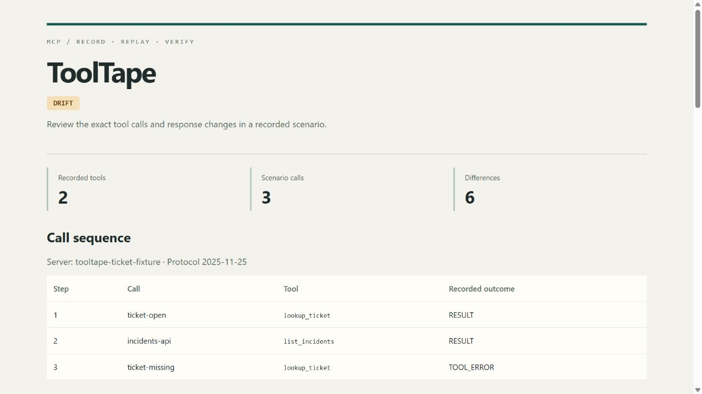

# ToolTape

Record an MCP tool session, replay it offline, and check what changes when the server changes.

[](https://github.com/Almeida96/tooltape/actions/workflows/ci.yml)
[](https://adoptium.net/temurin/releases/?version=21)
[](LICENSE)

An agent test can fail because a tool returned different data, because its schema changed, or because an external service was unavailable. ToolTape captures an explicit sequence of MCP calls in a local JSON file. Its replay server gives the same responses to a later run. Its comparison command identifies changed definitions, arguments, results and errors, with JSON pointers back to both recordings.

Use it to reproduce a tool-dependent failure, build stable agent integration tests, or review an MCP server upgrade before changing the version used by your agents.



*The bundled demo uses synthetic support tickets. The report above is produced by actual calls to its local MCP server.*

## Try it

Install Java 21 or later, download and extract [the release ZIP](https://github.com/Almeida96/tooltape/releases/latest), then run:

```sh
./bin/tooltape demo --dir demo-output
```

On Windows:

```powershell
.\bin\tooltape.bat demo --dir demo-output
```

The directory must not exist. The demo records three calls against a local fixture, records a changed version, then starts the offline replay server and checks every recorded outcome. Open `demo-output/comparison.html` to inspect the differences. JSON and Markdown reports are included. No API key or external service is needed for this demo.

To build from source:

```sh
./gradlew test installDist
./build/install/tooltape/bin/tooltape demo --dir demo-output
```

Use `gradlew.bat` and `tooltape.bat` on Windows. Source builds need network access to download the pinned build dependencies.

## Record a server

Write the calls you want to record. IDs are local labels for comparison and reporting; they are not JSON-RPC request IDs.

```json
{
  "schemaVersion": 1,
  "calls": [
    {"id": "ticket-open", "name": "lookup_ticket", "arguments": {"id": "INC-1042"}},
    {"id": "incidents-api", "name": "list_incidents", "arguments": {"service": "payments-api"}}
  ]
}
```

Pass the server executable and its arguments after `--`. For example, with your own Java MCP server:

```sh
tooltape record --scenario scenario.json --out baseline.tape.json -- java -jar support-mcp.jar
```

`record` and `verify` execute real tool calls. Use a test account and a reviewed scenario. ToolTape starts the executable directly, inherits its working directory and environment, and never retries a tool call. It validates the complete scenario's tool names before calling any of them. It does not sandbox the server or implement an approval system.

The tape stores the tool catalog, ordered arguments, complete results or RPC errors, and a semantic SHA-256 checksum. It does not store command-line arguments or environment variables. Tool arguments and responses may still contain secrets or personal data: inspect them before sharing a recording.

## Replay with an agent

Configure a stdio MCP server in your agent's MCP settings. Adapt the enclosing configuration to your client; this is the common `mcpServers` form:

```json
{
  "mcpServers": {
    "support-replay": {
      "command": "/absolute/path/to/tooltape/bin/tooltape",
      "args": ["serve", "--tape", "/absolute/path/to/baseline.tape.json"]
    }
  }
}
```

On Windows, use `java` directly with the distribution's libraries to avoid clients that cannot launch `.bat` files:

```json
{
  "mcpServers": {
    "support-replay": {
      "command": "java",
      "args": ["-cp", "C:/tools/tooltape/lib/*", "io.github.almeida96.tooltape.Main", "serve", "--tape", "C:/fixtures/baseline.tape.json"]
    }
  }
}
```

The replay exposes the captured tools and their schemas. Each call must match the next recorded tool name and arguments. A mismatch returns `REPLAY_MISMATCH` without consuming a response. A matched call consumes one entry, including recorded failures. After the final call, the server returns `REPLAY_EXHAUSTED`. Restart the replay process to reset it.

Replay never launches the original server. It identifies its responses as prerecorded and changes tool annotation hints to describe offline replay. It is deliberately sequential: agents that choose a different call order need a different scenario.

## Check an upgrade

Run the baseline calls against an updated server:

```sh
tooltape verify --tape baseline.tape.json --format html --out upgrade.html -- java -jar support-mcp-v2.jar
```

Or compare two existing recordings without launching anything:

```sh
tooltape compare --baseline baseline.tape.json --candidate candidate.tape.json --format md
```

| Exit | Meaning |
|---:|---|
| `0` | Command succeeded; a comparison found no unignored differences. |
| `1` | Invalid input, process failure or protocol failure. No passing verdict. |
| `2` | A comparison found behavioral drift. |

Object key order and equivalent JSON numbers do not create differences. Array order, strings, missing values, schemas, arguments, errors and result fields do. Timing and server identity metadata are informational. Explicit [ignore policies](docs/comparison.md) can exclude selected volatile result values; every exclusion remains in the report.

`PASS` describes the recorded observations under the selected policy. It does not prove backward compatibility, agent quality, or correctness for inputs outside the scenario. `DRIFT` may be an intentional change that needs review.

## Commands

| Command | Purpose |
|---|---|
| `record` | Capture a scenario against a real stdio server. |
| `serve` | Expose one tape as a sequential offline MCP server. |
| `verify` | Run baseline calls against a server and compare the observations. |
| `compare` | Compare two saved tapes. |
| `inspect` | Show inventory and call outcomes without argument/result payloads. |
| `show --call ID` | Read one full recorded exchange. |
| `demo` | Run a complete local record, compare and replay example. |

Run `tooltape --help` for flags. Reports support `json`, `md` and standalone `html`. Output files must be new; commands do not overwrite existing evidence.

## Scope

- Java 21, MCP stdio tools; protocol versions `2025-11-25` and `2025-06-18`.
- Up to 100 scenario calls, 256 tools, 32 inventory pages, 1 MiB protocol frames and 16 MiB input tapes. Requests have a configurable deadline, including blocked writes.
- Tool result payloads and RPC failures are preserved separately. Schemas are recorded and compared; ToolTape is not a full JSON Schema validator.
- No HTTP transport, hosted service, resources, prompts, tasks, sampling or elicitation. No model provider dependency.
- No latency benchmarking, automatic secret redaction or encrypted storage. HTML and Markdown reports may include captured data.

The Java tests cover comparison semantics, tampering, replay order, protocol failures and subprocess cleanup. Python smoke checks use the official MCP SDK as both an independent client and an independent server. CI runs on Linux and Windows.

Read the [cassette format](docs/format.md), [comparison rules](docs/comparison.md), [protocol behavior](docs/protocol.md), and [contribution guide](CONTRIBUTING.md).

MIT licensed. See [LICENSE](LICENSE).
